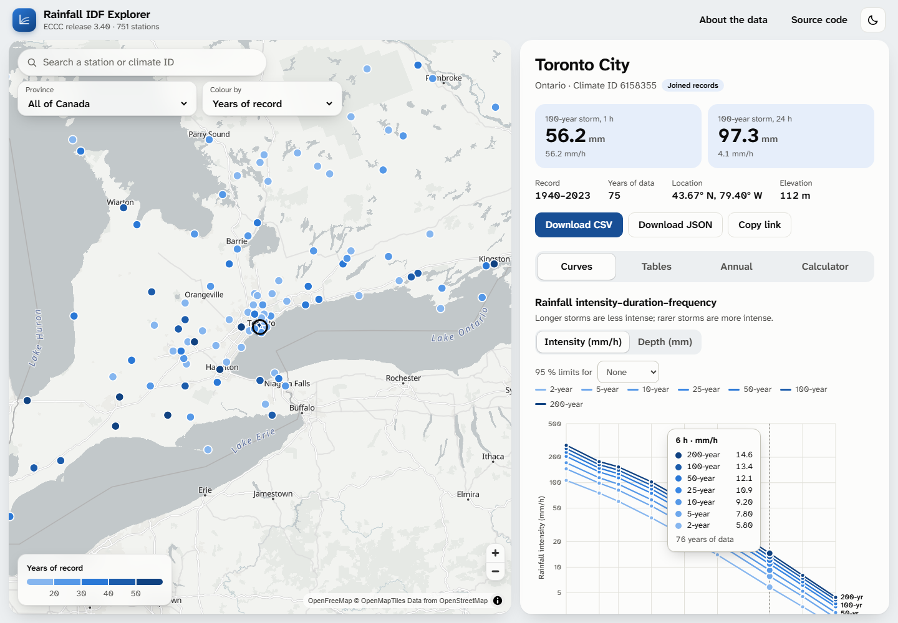

# ECCC Rainfall IDF Explorer

[](https://github.com/andreschardong/eccc-idf-explorer/actions/workflows/ci.yml)
[](LICENSE)

An interactive map and chart viewer for Environment and Climate Change Canada's rainfall
**intensity-duration-frequency (IDF)** data: **release 3.40**, 751 stations, 5 minute to 24 hour
storms, 2- to 200-year return periods.

**[Open the explorer](https://eccc-idf-explorer.andreschardong.workers.dev)**

<picture>
  <source media="(prefers-color-scheme: dark)" srcset="docs/images/explorer-dark.png">
  
</picture>

## What you can do

- **Find a station** on a map that groups nearby stations into numbered circles, coloured by group size, and
  separates them as you zoom in. Colour the stations by years of record or by the 100-year, 1-hour or 24-hour design depth, or
  search by name, climate ID or province. Station links are shareable (`#/station/6158355/curves`).
- **Choose the base map.** Light mode offers light grey, streets and bright maps; dark mode offers slate and
  charcoal; both offer satellite imagery. Each theme remembers its own choice.
- **Read the curves.** ECCC's published values are plotted as dots, never joined, and ECCC's fitted equation
  (`R = A × T^B`, from Table 3 of each station file) is drawn as a line for every return period, as on ECCC's own
  graphs. Switch between intensity (mm/h) and depth (mm), turn the lines off, add a 95 % confidence band, and read
  every equation in words. A tooltip and the arrow keys give the values by duration.
- **See the underlying numbers.** Depth, intensity with confidence limits, and the `R = A · T^B` fit
  as tables, plus every year's annual maximum against the 2-, 10- and 100-year depths.
- **Interpolate.** A calculator evaluates the fit for any duration from 5 minutes to 24 hours and
  shows ECCC's published value next to it where one exists.
- **Take the data with you.** CSV and JSON download for every station.
- **See and download ECCC's own files for every station.** A **Download files** button sits beside Download CSV and
  Download JSON. It opens the Files tab: view the official IDF graph, quantile-quantile plot, return-level plot and
  trend plot, read the station's text file in place, download any file (PDF, PNG or TXT) under ECCC's own name, or
  take all nine as one ZIP. See [Official files](#official-files).

It works in light and dark, on phones, with a screen reader (the tables are the text alternative to
the charts), and with reduced motion.

## Official files

ECCC's own PDF, PNG and text files are 770 MB (6,759 files, nine per station), so they are **not in git**. They
are unpacked and served as static assets by a Cloudflare Worker, at
`https://eccc-idf-files.andreschardong.workers.dev/v3.40/stations/<climate ID>/`, under ECCC's own file names.
The address of each station's files is built from one field in its JSON (`officialFileStem`); the host is set in
[`site/src/config.ts`](site/src/config.ts).

```sh
node scripts/publish-official-files.mjs               # unpack release 3.40 and deploy it (needs: npx wrangler login)
node scripts/publish-official-files.mjs --no-deploy   # just prepare official-files/ to look at it
```

The script runs `eccc-idf extract-official-files`, adds a landing page and cache headers, and deploys with
[Wrangler](https://developers.cloudflare.com/workers/wrangler/). A deployment is a snapshot of the whole folder, so
keep `official-files/` between releases: unpacking release 3.41 next to `v3.40` publishes both.

## Run it

You need Node.js 22.12 or later. The data is already in the repository.

```sh
cd site
npm ci
npm run dev        # http://localhost:5173
```

`npm run build` writes a static site to `site/dist` that any web host can serve.

## Publish

The explorer is served by a Cloudflare Worker with static assets, the same way as
[andreschardong.com](https://andreschardong.com), at https://eccc-idf-explorer.andreschardong.workers.dev.

```sh
cd site
npx wrangler login      # once
npm run deploy          # builds, then uploads site/dist
```

The settings are in [`site/wrangler.jsonc`](site/wrangler.jsonc) and the cache headers in
[`site/public/_headers`](site/public/_headers).

## Regenerate the data

Only needed when ECCC publishes a new release. You need the [.NET 10 SDK](https://dotnet.microsoft.com/download).

```sh
node scripts/update-data.mjs                  # downloads release 3.40 (665 MB) and rebuilds
node scripts/update-data.mjs <url-or-zip>     # a newer release
```

This runs the `eccc-idf` tool, which reads the whole download, **cross-checks every value against
ECCC's own flat tables** and only then writes `site/public/data`. For release 3.40 that is 751
stations and 147,947 values in agreement. You can run the check alone:

```sh
dotnet run --project src/EcccDataExplorer.Cli -- verify path/to/idf_v3-40_2025-12-5.zip
```

## How it works

```
ECCC zip ──► EcccDataExplorer.Idf ──► cross-check ──► site/public/data/*.json ──► static site
 (751 .txt     parse the four tables      against ECCC's      (index + one file       (Vite, TypeScript,
  files)       in each station file       flat tables         per station)           MapLibre, SVG charts)
```

| Folder | What it is |
|---|---|
| `src/EcccDataExplorer.Idf` | .NET 10 library: reads the ECCC download, parses station files, cross-checks, writes the site JSON |
| `src/EcccDataExplorer.Cli` | The `eccc-idf` command (`build-site-data`, `verify`) |
| `tests/EcccDataExplorer.Idf.Tests` | xUnit v3 tests, with real ECCC station files as fixtures |
| `site` | The web app: TypeScript (strict), Vite, MapLibre GL, hand-written SVG charts, Vitest and Playwright tests |
| `scripts` | `update-data.mjs` (rebuild the JSON) and `publish-official-files.mjs` (host ECCC's own files on Cloudflare) |
| `docs/data-format.md` | The ECCC file format and the quirks found in it |

There is no server and no database. The site fetches `stations.json` once and one small JSON file
per station on demand.

## Test

```sh
dotnet test --solution ECCCDataExplorer.slnx          # 60 tests: parser, exporter, cross-check, CLI
cd site
npm test                                              # 137 unit and component tests (Vitest, happy-dom)
npm run typecheck
npx playwright install chromium && npm run test:e2e   # 40 browser tests against the production build
```

- The **parser tests** run against real station files, including the awkward ones: stations with durations ECCC
  did not analyse, statistics that print as `*****` or `NaN`, and a "warning" block inside a data table. See
  [docs/data-format.md](docs/data-format.md).
- The **component tests** run the real UI code (tables, calculator, search, both charts, the Official tab, the two About
  dialogs, the dark basemap's colours and the whole station panel) against real station data.
- The **browser tests** drive the built site in Chromium with the basemap and files host stubbed, so they never
  depend on the internet. They cover search, grouping, tabs, keyboard use, downloads, deep links, the back button,
  dark mode and a phone layout, and they fail on any console error. They also run an
  [axe-core](https://github.com/dequelabs/axe-core) accessibility scan (WCAG 2.2 A and AA) on every view.

CI runs all three on every push and pull request. Run the same checks before `npm run deploy`.

## Using the numbers

This is an independent project, **not affiliated with or endorsed by ECCC**. It shows ECCC's values
unchanged. Before using any value for design, read ECCC's own guidance on using IDF curves
(*Best Practices for Using IDF Curves*, published beside the download), which covers short records,
extrapolation and climate change, and cite the official release.

ECCC's curves describe the climate of the past. To update IDF curves for climate change, at gauged and ungauged
locations, use the [IDF_CC tool](https://www.idf-cc-uwo.ca), developed at Western University.

## Credits and licence

- Code: [MIT](LICENSE) © Andre Schardong, a senior software engineer and licensed professional engineer (P.Eng.)
  who builds engineering software for hydrology, flood risk and climate change adaptation, and the lead author of
  the paper that describes the IDF_CC tool: Schardong, A., Simonovic, S. P., Gaur, A. and Sandink, D. (2020),
  [Web-Based Tool for the Development of Intensity Duration Frequency Curves under Changing Climate at Gauged and
  Ungauged Locations](https://doi.org/10.3390/w12051243), *Water* 12(5), 1243.
- Data: © Environment and Climate Change Canada, used under the
  [Open Government Licence – Canada](https://open.canada.ca/en/open-government-licence-canada).
- Base maps: [OpenFreeMap](https://openfreemap.org), © OpenMapTiles, data © OpenStreetMap contributors; satellite
  view: imagery © Esri, Maxar, Earthstar Geographics and the GIS User Community.
- Third-party components and fonts: see [THIRD_PARTY_NOTICES.md](THIRD_PARTY_NOTICES.md).

Contributions are welcome; see [CONTRIBUTING.md](CONTRIBUTING.md).
